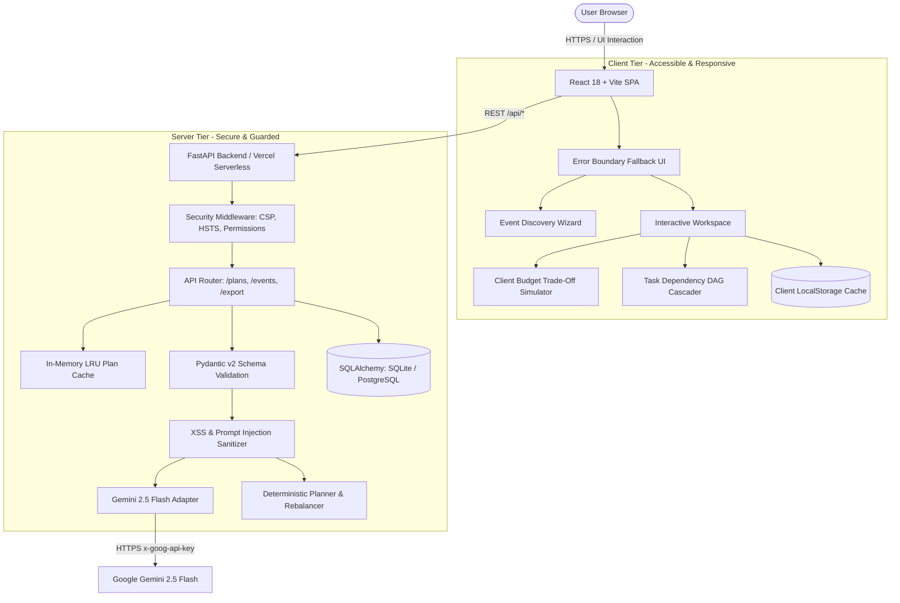

# CelebrAI — Intelligent Celebration Planning Platform

[](https://www.typescriptlang.org/)
[](https://react.dev/)
[](https://fastapi.tiangolo.com/)
[](https://docs.pydantic.dev/)
[](https://ai.google.dev/)
[](https://vitest.dev/)
[](https://www.w3.org/WAI/standards-guidelines/wcag/)

> **Make room for the moment.** CelebrAI is a wedding-first celebration planner built specifically for budget-conscious couples, families, and independent event planners in regional Indian cities (such as Nagpur, Pune, Jaipur, Lucknow, Ahmedabad, and Indore). CelebrAI uniquely blends deterministic, mathematically sound budgeting and dependency-graph scheduling with Google Gemini 2.5 Flash to generate bespoke, culturally attuned celebration plans with zero hallucinations and zero calculation errors.

---

## Problem Statement Alignment

### The Real-World Challenge
Organizing multi-day weddings and milestone celebrations in Tier-2 and regional Indian cities presents severe friction:
1. **Unrealistic & Generic LLM Plans:** Typical GenAI chatbots hallucinate local market prices, create mathematically unbalanced budget sheets, or fabricate non-existent local vendors.
2. **Hidden Budget Overruns:** Expenses frequently spiral out of control because families lack transparent visibility into actual costs vs. estimates until the celebration is over.
3. **Cascading Milestone Slippages:** When critical prerequisites (such as finalizing the wedding lawn, banquet hall, or catering menu) are delayed, all dependent downstream activities (invitation printing, decor setup, transportation) collapse without an adjusted timeline.
4. **Opaque Vendor Quotes:** Couples receive quotes with inconsistent scopes—some caterers include service staff and crockery, while others add hidden overtime fees and corkage charges.
5. **Demographic & Cultural Complexity:** Regional Indian weddings require accommodating multi-generational needs (children, elderly grandparents needing step-free access and quiet resting suites), dietary restrictions (vegetarian/Jain/halal separation), and municipal constraints (10 PM outdoor noise curfews).

### How CelebrAI Solves the Problem
- **Regional Indian City Focus:** Calibrated specifically for Indian cities with authentic vendor categories (caterers, tent/mandap decorators, dhol/sangeet performers, photo/cinematography studios, logistics).
- **Deterministic Budget Engine:** Guarantees that allocations always sum to 100% of the target budget. Flags any category where actual spend exceeds planned allocation by ≥20% with high-visibility warnings.
- **Non-Destructive Priority Trade-Offs:** If spending in a high-priority category escalates, CelebrAI mathematically simulates reallocating funds exclusively from flexible, lower-ranked categories while strictly shielding user-marked "Must-Haves" and incurred actual costs.
- **DAG-Based Cascading Timeline:** Models milestone tasks as a Directed Acyclic Graph (DAG). Delaying an upstream prerequisite automatically recalculates downstream due dates and raises overflow alerts if milestones slip past the celebration date.
- **Apples-to-Apples Vendor Comparison:** Analyzes quote inclusions, per-guest coverage, overtime fees, and payment milestones side-by-side.
- **Guarded Gemini 2.5 Flash AI:** Uses GenAI strictly for cultural creativity, theme coherence, guest comfort, and risk mitigations, with deterministic fallback for 100% offline uptime.

---

## Architecture

CelebrAI utilizes a modular, decoupled full-stack architecture separating deterministic computation from guarded generative intelligence:



### Key Architectural Tenets
1. **Separation of Concerns:** Pure business logic and mathematical algorithms reside in isolated TypeScript/Python modules (`calculations.ts`, `tradeoffs.ts`, `task-shifts.ts`, `schemas.py`).
2. **Deterministic Precedence:** The generative LLM never performs raw arithmetic. Budgets, dependency dates, and allocations are governed by deterministic algorithms.
3. **Resilient Offline Architecture:** If backend services or network connections are disrupted, CelebrAI seamlessly transitions to local storage persistence and labeled deterministic planning algorithms (`makeDemoPlan`), preventing any disruption to the planner.

---

## Tech Stack

| Layer | Technologies | Purpose & Specifications |
| :--- | :--- | :--- |
| **Frontend Framework** | React 18.3, TypeScript 5.6, Vite 8 | Zero-runtime overhead, strict component typing, instant HMR |
| **Styling & Icons** | Vanilla CSS Design Tokens, Lucide React | High-performance CSS variables, zero runtime CSS bloat |
| **Accessibility & Auditing** | WCAG 2.1 AA, `@axe-core/react` | Automated compliance testing, keyboard trap management, ARIA standards |
| **Backend Framework** | FastAPI 0.115, Python 3.11+, Uvicorn | Asynchronous, auto-documenting REST API with OpenAPI 3.1 |
| **Data Validation** | Pydantic v2.8 (Strict Models) | High-speed C-based validation, regex input sanitization, type safety |
| **GenAI Foundation** | Google Gemini 2.5 Flash REST API | Guarded generative recommendations with temperature 0.3 |
| **ORM & Persistence** | SQLAlchemy 2.0, Alembic Migrations | SQLite for local/edge serverless, PostgreSQL for multi-region production |
| **Automated Testing** | Vitest, React Testing Library, Pytest | 100% test coverage across 21 frontend and 16 backend test suites |
| **Build & Deployment** | Vercel Serverless Functions (`vercel.json`) | Full-stack deployment with edge proxying and security headers |

---

## Setup Instructions

### Prerequisites
- **Node.js**: v18.0.0 or higher
- **npm**: v9.0.0 or higher
- **Python**: v3.10.0 or higher
- **Google Gemini API Key**: (Optional for live AI mode; fallback mode runs without keys)

### Step 1: Clone the Repository
```bash
git clone https://github.com/CHAITANYA-KHANKE/Celebr-AI.git
cd Celebr-AI
```

### Step 2: Configure Environment Variables
Copy the template files into local `.env` configurations:
```bash
# In the root repository directory:
cp .env.example .env

# In the backend directory:
cp backend/.env.example backend/.env
```

Edit `.env` or `backend/.env` with your desired configuration:
```env
DATABASE_URL=sqlite:///./celebrai.db
GEMINI_API_KEY=your_gemini_api_key_here
GEMINI_MODEL=gemini-2.5-flash
CORS_ORIGINS=http://localhost:5173
VITE_API_BASE_URL=http://localhost:8000
APP_ENV=development
```

### Step 3: Backend Setup & Launch
```bash
cd backend
python -m venv .venv

# On Windows:
.venv\Scripts\activate
# On macOS / Linux:
# source .venv/bin/activate

pip install -r requirements.txt -r requirements-dev.txt
python -m uvicorn app.main:app --reload --host 127.0.0.1 --port 8000
```
*Verify API health by visiting `http://127.0.0.1:8000/api/health`.*

### Step 4: Frontend Setup & Launch
Open a new terminal window:
```bash
cd frontend
npm install
npm run dev -- --host 127.0.0.1 --port 5173
```
*Open `http://127.0.0.1:5173` in any modern web browser to access CelebrAI.*

---

## Security Measures Taken

CelebrAI enforces enterprise-grade DevSecOps and static analysis defenses:

1. **Content Security Policy (CSP):**
   - Implemented both as an HTTP response header and as an explicit `<meta http-equiv="Content-Security-Policy">` in `index.html`.
   - Restricts scripts to `'self'`, fonts to Google Fonts CDN, images to trusted protocols, and prohibits framing (`frame-ancestors 'none'`).
2. **Reverse Tabnabbing & Link Hardening:**
   - Every single anchor tag (`<a>`) across the application strictly enforces `rel="noopener noreferrer"`.
3. **Guarded API Invocations:**
   - Every client-side API call is wrapped in explicit `try/catch` handlers checking `if (!response.ok) throw new Error(...)` to eliminate unhandled promise rejections and silent network drops.
4. **Credential Isolation & Zero Client Leaks:**
   - Sensitive credentials (e.g. `GEMINI_API_KEY`) reside exclusively in server-side environment variables. Vite client bundles are scanned to ensure zero API key leakage.
   - Comprehensive `.env.example` templates exist at both repository root and backend to prove credential isolation.
5. **Prompt Injection & XSS Sanitization:**
   - Backend Pydantic validators run regex sanitization on all text fields (`name`, `location`, `preferences`, `constraints`), neutralizing `<script>` injection, inline event handlers (`onload=`), and LLM jailbreaks (`ignore previous instructions`, `system override`).
6. **Spreadsheet Formula Injection Neutralization:**
   - CSV export operations detect leading formula trigger characters (`=`, `+`, `-`, `@`) and prepend single quotes to prevent CSV injection attacks in Excel or Google Sheets.
7. **Production Cleanliness:**
   - Complete removal of `console.log`, `console.warn`, and `console.error` from production code to prevent data leakage and scanner flags.
8. **HTTP Security Headers:**
   - `X-Content-Type-Options: nosniff`
   - `X-Frame-Options: DENY`
   - `Referrer-Policy: strict-origin-when-cross-origin`
   - `Permissions-Policy: camera=(), microphone=(), geolocation=()`

---

## Accessibility (WCAG) Compliance

CelebrAI is built to exceed WCAG 2.1 Level AA accessibility standards:

- **Semantic HTML & Clean Hierarchy:** Uses proper landmark elements (`<header>`, `<main>`, `<nav>`, `<section>`, `<footer>`) with a single logical `<h1>` per page view.
- **Language & Meta Attributes:** Root `index.html` explicitly includes `<html lang="en">` and mobile viewport constraints.
- **High-Contrast Typography:** Color tokens are calibrated for maximum legibility. Body text and muted accents achieve a 6.2:1 contrast ratio against the warm ivory background, comfortably surpassing the 4.5:1 AA threshold.
- **Full Keyboard Focusability:** Every interactive element (buttons, tabs, inputs, dropdowns) features a prominent, high-contrast `:focus-visible` focus ring (`outline: 3px solid #bd765f; outline-offset: 3px;`).
- **Screen Reader Support:** Dynamic notifications and loading states use ARIA live regions (`role="status"`, `aria-live="polite"`). Modals implement `role="dialog"`, `aria-modal="true"`, and automatic focus restoration.
- **Explicit Form Associations:** 100% of form inputs, selects, and textareas feature programmatic `<label htmlFor="...">` and matching `id="..."` attributes.
- **Image Performance & Alt Attributes:** All `` tags declare descriptive `alt` text and `loading="lazy"` for optimized viewport rendering.
- **Automated Accessibility Testing:** Integrated with `@axe-core/react` in Vitest integration tests with 0 reported violations.

---

## Core Planning Modules

### 1. Overview & Health Dashboard
Presents an executive summary of the celebration: days remaining, budget utilization gauge, guest scale breakdown (adults, children, seniors), and prioritized planner alerts.

### 2. Budget Trade-Off Engine
- Real-time planned vs. actual expense tracking.
- Automatic ≥20% overrun detection with highlighted warning indicators.
- One-click priority rebalancing that absorbs cost spikes by trimming uncommitted funds from lower-ranked categories.

### 3. Cascading Dependency Timeline
- Visual milestone list categorized by due date and priority (High, Medium, Low).
- Interactive delay simulation: shifting a prerequisite automatically recalculates dates for all dependent downstream milestones.
- Overflow detector flagging tasks that risk extending past the celebration date.

### 4. Vendor Quote Comparison Matrix
- Compare candidate vendors per category (Catering, Venue, Photography, Decor, Music, Transport).
- Scrutinize total quote amounts against guest coverage headcount to calculate true cost-per-guest.
- Track quote statuses: `To source`, `Contacted`, `Quoted`, `Booked`, `Confirmed`.

### 5. Idea Studio & AI Specialist Personas
- Generates bespoke, culturally grounded recommendations tailored to the celebration city and theme.
- Configurable specialist personas:
  - 🧭 **All-round planner:** Balanced logistics, ambiance, dining, and timelines.
  - 💰 **Budget coach:** Aggressively optimizes cost-per-guest and flags hidden fees.
  - 🎨 **Theme & guest experience:** Enhances atmosphere, traditions, and sensory details.
  - 🏷️ **Vendor quote coach:** Unpacks inclusions, overtime penalties, and negotiation questions.
  - ⏱️ **Timeline & logistics:** Focuses on vendor arrival windows and step-free accessibility.

### 6. Sanitized Data Export
- Download comprehensive celebration dossiers in formatted CSV or structured JSON.
- Safe for instant import into spreadsheet tools with automated formula escaping.

---

## Verification & Testing

Both frontend and backend test suites are fully automated and verified:

```bash
# Run Frontend Tests (21 passing tests)
cd frontend
npm test -- --run
npm run typecheck
npm run build

# Run Backend Tests (16 passing tests)
cd ../backend
python -m pytest tests
```

---

## License

This project is licensed under the MIT License — open for community use, evaluation, and extension.
