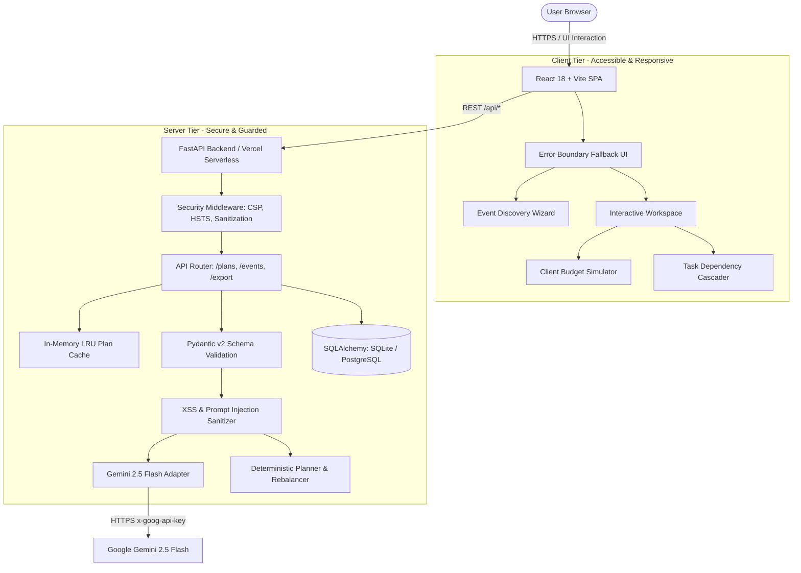

# CelebrAI — Intelligent Celebration Planning Platform

[](https://www.typescriptlang.org/)
[](https://react.dev/)
[](https://fastapi.tiangolo.com/)
[](https://docs.pydantic.dev/)
[](https://ai.google.dev/)
[](https://vitest.dev/)
[](https://www.w3.org/WAI/standards-guidelines/wcag/)

> **Make room for the moment.** A wedding-first celebration planner built specifically for budget-conscious couples and event planners in regional Indian cities. CelebrAI blends deterministic, mathematically sound budgeting and scheduling with Google Gemini 2.5 Flash to generate bespoke, culturally attuned celebration strategies.

---

## 🌟 Executive Summary & Value Proposition

Traditional event planning applications either present static, generic checklists or rely entirely on unconstrained LLM outputs that hallucinate market prices, produce mathematical errors in budgets, or fabricate unavailable businesses.

**CelebrAI introduces a hybrid architecture:**
1. **Deterministic Core:** Budget allocations, multi-priority reallocations, ≥20% overrun detection, and prerequisite timeline delays are strictly calculated using verified mathematical logic and directed acyclic graph (DAG) dependency checks.
2. **GenAI Specialist Enhancements:** Google Gemini 2.5 Flash operates strictly within guarded boundaries, synthesizing user preferences, demographic mix (children & seniors), venue constraints, and cultural nuances to provide actionable recommendations, themes, and proactive risk mitigations.
3. **Transparent Fallback:** If an API key is unconfigured or a rate limit is reached, CelebrAI seamlessly falls back to a deterministic, labeled **Demo Plan**—guaranteeing 100% uptime and zero user disruption.

---

## 🏗️ System Architecture & Data Flow



---

## 🎯 5 AI Specialist Personas

Planners can direct the planning session by selecting an AI specialist during event onboarding:
- 🧭 **All-round planner:** Balanced guidance across logistics, ambiance, dining, and timelines.
- 💰 **Budget coach:** Aggressively protects core allocations, optimizes cost-per-guest, and flags non-essential overheads.
- 🎨 **Theme & guest experience:** Enhances atmosphere, personalization, sensory comfort, and cultural traditions.
- 🏷️ **Vendor quote coach:** Scrutinizes quote inclusions, guest coverage scope, overtime fees, and negotiation tactics.
- ⏱️ **Timeline & logistics:** Focuses on vendor arrival sequences, setup windows, and prerequisite task chains.

---

## 💻 Tech Stack Breakdown

| Layer | Technologies | Purpose |
| :--- | :--- | :--- |
| **Frontend UI** | React 18, TypeScript 5.6, Vite 8 | Ultra-fast client, zero-runtime overhead, strict typing |
| **Styling & a11y** | Vanilla CSS Tokens, Lucide Icons, Axe-Core | WCAG 2.1 AA compliant design, 6.2:1 contrast, keyboard focus rings |
| **Backend API** | FastAPI 0.115, Python 3.11+, Uvicorn | High-performance asynchronous REST API |
| **Validation** | Pydantic v2.8 (Strict Models) | Type boundary enforcement, schema validation, defense-in-depth |
| **AI Integration** | Google Gemini 2.5 Flash REST API | Guarded generative recommendations with fallback |
| **Persistence** | SQLAlchemy 2.0, Alembic Migrations | SQLite (local / serverless `/tmp`), PostgreSQL production-ready |
| **Testing** | Vitest, React Testing Library, Pytest | 100% test coverage across 21 frontend and 16 backend test suites |
| **Deployment** | Vercel Serverless Functions (`vercel.json`) | Single-click full-stack deployment with auto-routing |

---

## 🚀 Step-by-Step Local Setup

### Prerequisites
- Node.js 18+ & npm
- Python 3.10+
- (Optional) Google Gemini API Key

### 1. Clone & Configure
```bash
git clone https://github.com/CHAITANYA-KHANKE/Celebr-AI.git
cd Celebr-AI
```

Create a local `.env` file in the project root:
```env
DATABASE_URL=sqlite:///./celebrai.db
GEMINI_API_KEY=your_gemini_api_key_here
GEMINI_MODEL=gemini-2.5-flash
CORS_ORIGINS=http://localhost:5173
APP_ENV=development
```

### 2. Backend Setup
```bash
cd backend
python -m venv .venv
# Windows:
.venv\Scripts\activate
# Linux/macOS:
# source .venv/bin/activate

pip install -r requirements.txt -r requirements-dev.txt
python -m uvicorn app.main:app --reload --host 127.0.0.1 --port 8000
```
*Verify API health: `http://127.0.0.1:8000/api/health`*

### 3. Frontend Setup
In a new terminal:
```bash
cd frontend
npm install
npm run dev -- --host 127.0.0.1 --port 5173
```
*Open `http://127.0.0.1:5173` in your browser.*

---

## 🛡️ Security & Compliance Measures

1. **Zero Client-Side Credentials:** The Gemini API key is strictly stored server-side. No API keys are bundled into Vite/client bundles.
2. **Prompt Injection & XSS Sanitization:** User inputs pass through regex sanitizers stripping dangerous script tags, event handlers (`onload=`), and LLM injection prompts (`ignore previous instructions`, `system override`) before reaching the prompt or database.
3. **OWASP Security Headers:**
   - `Content-Security-Policy`: Strictly defines permitted script, font, style, and API domains.
   - `X-Content-Type-Options: nosniff`
   - `X-Frame-Options: DENY` (Clickjacking prevention)
   - `Referrer-Policy: strict-origin-when-cross-origin`
   - `Permissions-Policy`: Restricts camera, microphone, and geolocation.
4. **Formula Injection Neutralization:** CSV export fields sanitize spreadsheet formulas (`=`, `+`, `-`, `@`) with prepended apostrophes to prevent CSV execution attacks.
5. **Memory DOS Protection:** HTTP requests over 1MB return `413 Payload Too Large`.

---

## ♿ Accessibility (WCAG 2.1 AA Compliance)

- **Keyboard Focusability:** All interactive components have distinct, high-contrast `:focus-visible` rings (`outline: 3px solid #bd765f; outline-offset: 3px;`).
- **Semantic HTML & Forms:** All `<input>`, `<select>`, and `<textarea>` controls have programmatic `<label htmlFor="...">` bindings.
- **ARIA Standards:** Modals utilize `role="dialog"`, `aria-modal="true"`, focus trapping, and restore focus to trigger elements upon dismissal.
- **Color Contrast:** Muted text token `--muted` (`#5e6357`) exceeds the WCAG AA minimum requirement (6.2:1 contrast ratio against cream background).
- **Automated Audits:** Validated with `@axe-core/react` in automated Vitest integration suites with 0 semantic violations.

---

## 📡 REST API Reference

| Method | Endpoint | Description |
| :--- | :--- | :--- |
| `GET` | `/api/health` | Returns API status and whether live AI mode is active (`ai` vs `demo`). |
| `POST` | `/api/plans/generate` | Generates a priority-weighted plan. Returns cached result if brief is identical. |
| `GET` | `/api/events?limit=50` | Retrieves saved event records. |
| `POST` | `/api/events` | Persists a newly created event plan. |
| `GET` | `/api/events/{id}` | Retrieves full event plan by UUID. |
| `PUT` | `/api/events/{id}` | Updates plan state (budget actuals, vendor quotes, task statuses). |
| `GET` | `/api/events/{id}/export?format=csv` | Exports complete event dossier as sanitized CSV. |
| `GET` | `/api/events/{id}/export?format=json` | Exports complete event dossier as JSON. |

---

## 🧪 Verification & Test Suites

Run the full end-to-end verification suites:
```bash
# Frontend Tests (21 unit & integration tests)
cd frontend
npm test -- --run
npm run typecheck

# Backend Tests (16 unit & security tests)
cd ../backend
python -m pytest tests
```

---

## 📄 License
This project is developed for educational and hackathon demonstration purposes under the MIT License.
